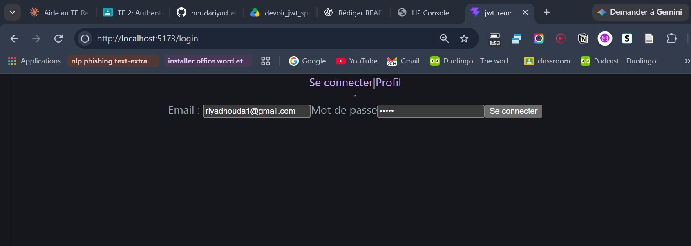
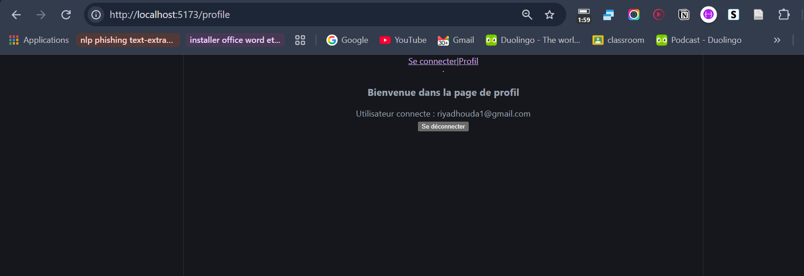
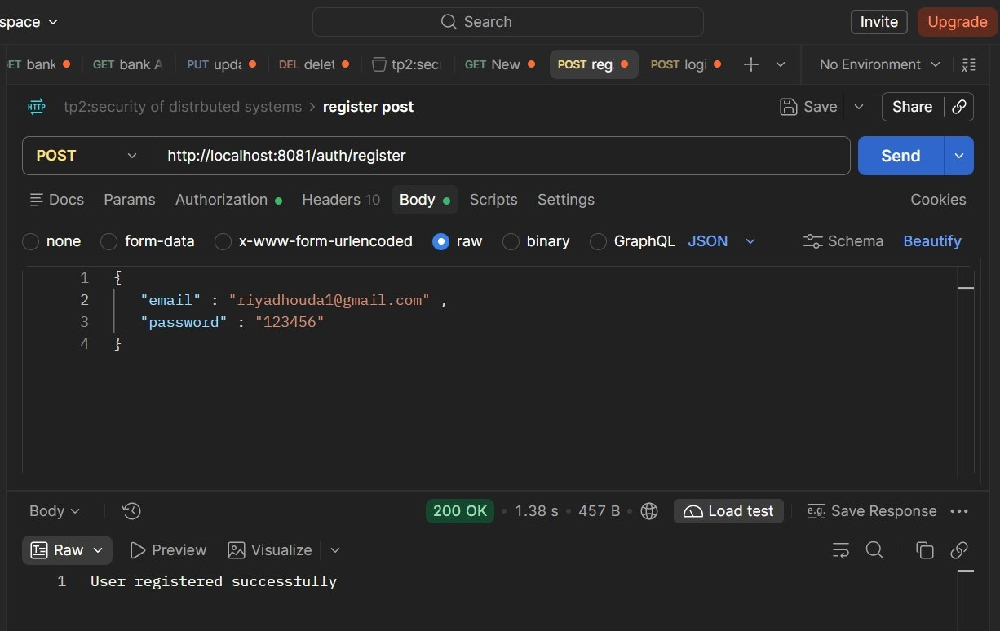
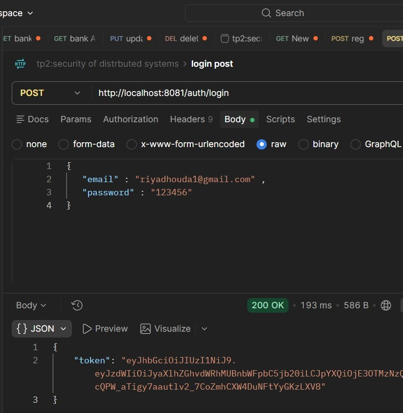
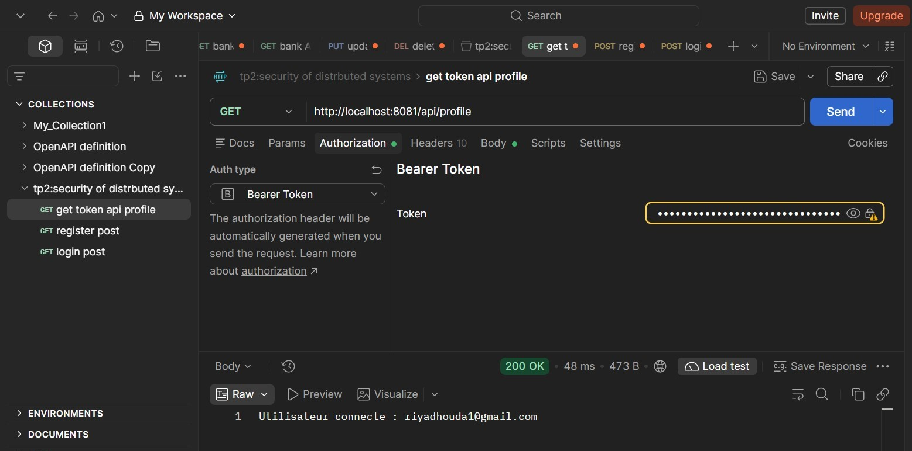

# JWTSpringApplication : Authentification JWT avec Spring Boot et React

Application Full Stack de gestion de l'authentification utilisant **Spring Boot**, **Spring Security**, **JWT** et **React**.

Ce projet met en œuvre un système d'inscription et de connexion sécurisé. Après authentification, l'utilisateur reçoit un JSON Web Token (JWT) qui lui permet d'accéder aux ressources protégées de l'application.

## Sommaire

- [Fonctionnalités](#fonctionnalités)
- [Technologies utilisées](#technologies-utilisées)
- [Architecture du projet](#architecture-du-projet)
- [Screenshots](#screenshots)
- [Prérequis](#prérequis)
- [Installation et lancement](#installation-et-lancement)
- [API REST](#api-rest)
- [Fonctionnement de l'authentification JWT](#fonctionnement-de-lauthentification-jwt)
- [Sécurité](#sécurité)
- [Tests](#tests)
- [Améliorations possibles](#améliorations-possibles)

## Fonctionnalités

### Backend
- Inscription d'un nouvel utilisateur.
- Vérification de l'unicité de l'adresse e-mail.
- Hachage des mots de passe avec BCrypt.
- Authentification avec Spring Security.
- Génération et validation de JWT.
- Protection des endpoints avec un filtre JWT personnalisé.
- Gestion des utilisateurs avec Spring Data JPA.
- Utilisation d'une base de données H2 en mémoire.

### Frontend
- Interface de connexion avec React.
- Envoi des identifiants au backend avec Axios.
- Stockage du JWT après une authentification réussie.
- Ajout automatique du JWT dans les requêtes HTTP protégées.
- Protection de la page Profile.
- Déconnexion de l'utilisateur.

## Technologies utilisées

| Technologie | Utilisation |
|---|---|
| Java 21 | Langage backend |
| Spring Boot | Développement de l'API REST |
| Spring Security | Authentification et autorisation |
| Spring Data JPA | Accès aux données |
| Hibernate | Mapping objet-relationnel |
| H2 Database | Base de données en mémoire |
| JJWT | Génération et validation des JWT |
| BCrypt | Hachage des mots de passe |
| Maven | Gestion des dépendances |
| React | Interface utilisateur |
| JavaScript | Développement frontend |
| Axios | Communication HTTP avec le backend |
| Vite | Serveur de développement frontend |

## Architecture du projet

Le projet est organisé en deux parties principales : le backend Spring Boot et le frontend React.

```text
JWTSpringApplication/
│
├── src/
│   └── main/
│       ├── java/net/riyad/tpjwtspringapplication/
│       │   ├── config/
│       │   │   └── SecurityConfig.java
│       │   ├── controllers/
│       │   │   ├── AuthController.java
│       │   │   └── UserController.java
│       │   ├── dto/
│       │   ├── entity/
│       │   ├── repository/
│       │   ├── security/
│       │   │   └── JwtFilter.java
│       │   └── service/
│       │       ├── CustomerUserDetailsService.java
│       │       └── JwtService.java
│       │
│       └── resources/
│           └── application.properties
│
├── frontend/
│   ├── public/
│   ├── src/
│   │   ├── components/
│   │   │   └── ProtectRoute.jsx
│   │   ├── pages/
│   │   │   ├── Login.jsx
│   │   │   └── Profile.jsx
│   │   ├── services/
│   │   │   └── api.js
│   │   ├── App.jsx
│   │   └── main.jsx
│   ├── package.json
│   └── vite.config.js
│
├── docs/
│   └── screenshots/
│       ├── login.jpg
│       └── profile.png
│
├── README.md
└── pom.xml
```

## Screenshots

### Login Interface



### User Profile



## API Testing with Postman

The REST API endpoints were tested using Postman.

### 1. User Registration



### 2. User Login



### 3. Get Authenticated User Profile



The login endpoint returns a JWT token, which is used in the `Authorization: Bearer` header to access protected endpoints such as `/api/profile`.

## Prérequis

Avant de lancer le projet, installer :

- JDK 21
- Node.js et npm
- Git

Le backend contient le Maven Wrapper (`mvnw.cmd`), ce qui permet de lancer Maven sans installation globale.

## Installation et lancement

### 1. Cloner le dépôt

```bash
git clone https://github.com/houdariyad-etu-gif/JWTSpringApplication.git
cd JWTSpringApplication
```

### 2. Configurer le backend

La configuration se trouve dans :

`src/main/resources/application.properties`

Les principaux paramètres sont :

| Paramètre | Valeur |
|---|---|
| Port backend | 8081 |
| Base de données | H2 en mémoire |
| Nom de la base | securitydb |
| Utilisateur H2 | sa |
| Expiration du JWT | 3600000 ms (1 heure) |

La clé secrète JWT est récupérée depuis la variable d'environnement `JWT_SECRET`. Elle ne doit pas être publiée dans le dépôt.

Sous Windows PowerShell, définir les variables avant de démarrer le backend :

```powershell
$env:JWT_SECRET="VOTRE_CLE_SECRETE_BASE64"
$env:JWT_EXPIRATION="3600000"
```

### 3. Démarrer le backend

Sous Windows PowerShell :

```powershell
.\mvnw.cmd spring-boot:run
```

Sous Linux ou macOS :

```bash
./mvnw spring-boot:run
```

Le backend sera accessible à :

`http://localhost:8081`

### 4. Installer et démarrer le frontend

Ouvrir un deuxième terminal :

```bash
cd frontend
npm install
npm run dev
```

Le frontend sera accessible à :

`http://localhost:5173`

## API REST

Les principaux endpoints exposés par le backend :

| Méthode | Endpoint | Accès | Description |
|---|---|---|---|
| POST | `/auth/register` | Public | Inscription d'un utilisateur |
| POST | `/auth/login` | Public | Authentification et génération du JWT |
| GET | `/api/hello` | Protégé | Accès à une ressource sécurisée |
| GET | `/api/profile` | Protégé | Consultation du profil utilisateur |

### Inscription – POST `/auth/register`

Exemple de requête :

```json
{
  "email": "utilisateur@example.com",
  "password": "mot-de-passe"
}
```

Le backend vérifie l'existence de l'adresse e-mail, hache le mot de passe avec BCrypt puis enregistre le nouvel utilisateur.

### Connexion – POST `/auth/login`

Exemple de requête :

```json
{
  "email": "utilisateur@example.com",
  "password": "mot-de-passe"
}
```

Après vérification des identifiants, le backend génère et retourne un JWT.

Exemple de réponse :

```json
{
  "token": "<JWT>"
}
```

### Consultation du profil – GET `/api/profile`

Cette route nécessite un JWT valide transmis dans l'en-tête HTTP :

```http
Authorization: Bearer <JWT>
```

Le backend identifie l'utilisateur authentifié et retourne les informations de son profil.

## Fonctionnement de l'authentification JWT

Le processus d'authentification suit les étapes suivantes :

1. L'utilisateur crée un compte via `/auth/register`.
2. Le backend vérifie l'adresse e-mail.
3. Le mot de passe est haché avec BCrypt.
4. L'utilisateur se connecte via `/auth/login`.
5. Spring Security vérifie les identifiants.
6. `JwtService` génère un JWT signé.
7. Le frontend reçoit et stocke le jeton.
8. Axios ajoute automatiquement le JWT aux requêtes protégées.
9. `JwtFilter` vérifie le jeton reçu.
10. Si le jeton est valide, l'utilisateur peut accéder à la ressource protégée.

## Sécurité

Les principaux mécanismes de sécurité implémentés sont :

- **BCrypt** : hachage des mots de passe avant leur stockage.
- **JWT signé** : authentification basée sur un jeton.
- **JwtFilter** : vérification du JWT à chaque requête protégée.
- **Spring Security** : gestion des règles d'accès.
- **Stateless authentication** : désactivation des sessions HTTP avec `SessionCreationPolicy.STATELESS`.
- **Routes publiques** : `/auth/**`.
- **Routes protégées** : `/api/**`.
- **CORS** : configuration permettant la communication entre le frontend exécuté sur le port 5173 et le backend sur le port 8081.

La clé secrète JWT doit rester privée et être fournie par une variable d'environnement.

## Tests

Le projet contient un test de démarrage Spring Boot permettant de vérifier le chargement du contexte de l'application.

Pour exécuter les tests sous Windows :

```powershell
.\mvnw.cmd test
```

## Améliorations possibles

- Ajouter des tests unitaires et d'intégration pour les endpoints d'authentification.
- Ajouter la validation des données d'entrée.
- Remplacer H2 par une base de données persistante.
- Ajouter une gestion plus détaillée des rôles et permissions.
- Améliorer la gestion des erreurs HTTP.
- Renforcer la configuration de sécurité pour un environnement de production.

---

