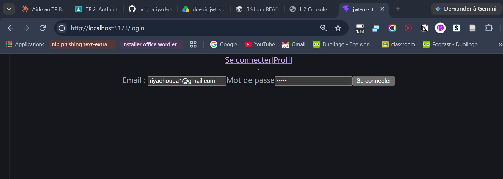
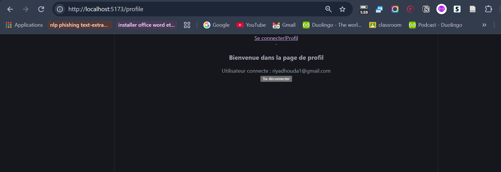

# Authentification JWT – Client React

Une application frontend React qui illustre l'authentification basée sur les JSON Web Tokens (JWT) avec une API REST. Elle propose une page de connexion, stocke le jeton d'authentification dans le navigateur, l'ajoute automatiquement aux requêtes API et protège l'accès à la page de profil pour les utilisateurs non authentifiés.

> **Périmètre du projet :** ce dépôt contient uniquement le frontend React. Le backend doit être exécuté séparément et exposer les endpoints d'authentification et de profil décrits ci-dessous.

## Présentation du projet

Cette application met en œuvre la partie cliente d'un mécanisme d'authentification JWT :

1. L'utilisateur saisit son adresse e-mail et son mot de passe dans le formulaire de connexion.
2. Le frontend transmet ces identifiants au backend.
3. Le backend authentifie l'utilisateur et renvoie un JWT.
4. Le frontend enregistre le jeton dans `localStorage`.
5. Un intercepteur Axios ajoute automatiquement le jeton aux requêtes API suivantes dans l'en-tête `Authorization: Bearer <token>`.
6. La route de profil vérifie la présence d'un jeton avant d'autoriser l'affichage de la page.
7. Si la requête de profil échoue, le frontend supprime le jeton enregistré et redirige l'utilisateur vers la page de connexion.

## Fonctionnalités

- **Formulaire de connexion** avec adresse e-mail et mot de passe.
- **Stockage du JWT** dans le `localStorage` du navigateur après une réponse de connexion réussie.
- **Client HTTP centralisé** configuré avec Axios.
- **Ajout automatique du jeton** grâce à un intercepteur Axios.
- **Protection de la route** donnant accès à la page de profil.
- **Logique de déconnexion** prévue pour supprimer le jeton enregistré et revenir à la page de connexion.
- **Navigation côté client** avec React Router.

## Technologies utilisées

| Technologie | Rôle |
|---|---|
| React 19 | Création de l'interface et gestion des composants |
| Vite 8 | Serveur de développement et outil de build |
| React Router 7 | Navigation côté client et protection des routes |
| Axios | Communication HTTP avec le backend |
| JavaScript (ES modules) | Langage et modules utilisés dans l'application |

## Structure du projet

```text
jwt-react/
├── public/
├── src/
│   ├── assets/
│   ├── components/
│   │   └── ProtectRoute.jsx
│   ├── pages/
│   │   ├── Login.jsx
│   │   └── Profile.jsx
│   ├── services/
│   │   └── api.js
│   ├── App.jsx
│   ├── App.css
│   ├── index.css
│   └── main.jsx
├── index.html
├── package.json
├── vite.config.js
└── eslint.config.js
```

### Rôle des principaux fichiers

| Fichier | Responsabilité |
|---|---|
| `src/main.jsx` | Initialise l'application React et l'enveloppe dans `BrowserRouter`. |
| `src/App.jsx` | Déclare la navigation et les routes de connexion et de profil. |
| `src/pages/Login.jsx` | Récupère les identifiants, appelle l'endpoint de connexion et enregistre le JWT reçu. |
| `src/components/ProtectRoute.jsx` | Vérifie la présence d'un jeton dans `localStorage` avant d'autoriser l'accès à la route de profil. |
| `src/pages/Profile.jsx` | Effectue une requête pour récupérer les informations du profil. En cas d'échec, le composant doit supprimer le jeton et rediriger vers la connexion. |
| `src/services/api.js` | Configure l'instance Axios et ajoute le JWT aux requêtes sortantes. |

## Prérequis

Avant de commencer, assurez-vous d'avoir installé :

- [Node.js](https://nodejs.org/) (une version récente compatible avec Vite 8 ; Node.js 22.13 ou supérieur est recommandé).
- npm (fourni avec Node.js).
- Un backend API opérationnel implémentant les endpoints décrits dans la section suivante.

## Installation et configuration

### 1. Cloner le dépôt

```bash
git clone <URL_DE_VOTRE_DEPOT>
cd jwt-react
```

Remplacez `<URL_DE_VOTRE_DEPOT>` par l'URL GitHub de votre dépôt.

### 2. Installer les dépendances

```bash
npm install
```

### 3. Configurer l'URL du backend

Le client Axios est actuellement configuré dans `src/services/api.js` :

```javascript
const api = axios.create({
    baseURL: "http://localhost:8081",
    headers: {
        "Content-Type": "application/json"
    }
});
```

Vérifiez que le backend est démarré à l'adresse `http://localhost:8081`. Si ce n'est pas le cas, modifiez `baseURL` pour utiliser l'adresse correspondant à votre backend.

### 4. Démarrer le serveur de développement

```bash
npm run dev
```

Vite affiche l'adresse locale dans le terminal (généralement `http://localhost:5173`). Ouvrez cette adresse dans votre navigateur.

## Contrat de l'API backend

Le frontend attend un backend exposant les endpoints suivants :

| Méthode | Endpoint | Objectif | Comportement attendu |
|---|---|---|---|
| `POST` | `/auth/login` | Authentifier un utilisateur | Reçoit l'adresse e-mail et le mot de passe, puis renvoie une réponse contenant le JWT dans `data.token`. |
| `GET` | `/profile` | Récupérer le profil de l'utilisateur connecté | Nécessite un JWT valide dans l'en-tête `Authorization`. |

### Requête de connexion

Le frontend envoie un corps JSON de la forme :

```json
{
  "email": "user@example.com",
  "password": "votre-mot-de-passe"
}
```

Le gestionnaire de connexion attend une réponse backend contenant une propriété `token` :

```json
{
  "token": "<JWT_TOKEN>"
}
```

Le jeton est récupéré depuis `resp.data.token`, puis enregistré dans `localStorage` sous la clé `token`.

### Requête authentifiée

Pour les requêtes effectuées avec l'instance Axios configurée, l'intercepteur ajoute automatiquement l'en-tête suivant :

```http
Authorization: Bearer <JWT_TOKEN>
```

Le backend doit vérifier la validité du jeton avant de renvoyer les ressources protégées.

## Déroulement de l'authentification

```text
Utilisateur
    |
    | Saisit son e-mail et son mot de passe
    v
Login.jsx
    |
    | POST /auth/login
    v
Backend API
    |
    | Renvoie un JWT
    v
Login.jsx
    |
    | Enregistre le jeton dans localStorage
    v
ProtectRoute.jsx
    |
    | Vérifie la présence du jeton
    v
Profile.jsx
    |
    | GET /profile
    | Authorization: Bearer <JWT>
    v
Le backend vérifie le JWT
    |
    +---- Jeton valide ------> Données du profil
    |
    +---- Jeton invalide/expiré --> Suppression du jeton et redirection vers /login
```

### Fonctionnement de la protection des routes

Le composant `ProtectRoute.jsx` lit la valeur `token` depuis `localStorage`.

- Si aucun jeton n'est trouvé, le composant `Navigate` de React Router redirige l'utilisateur vers `/login`.
- Si un jeton est présent, le composant enfant correspondant à la route protégée est affiché.

**À retenir :** cette vérification protège la navigation côté client, mais ne constitue pas une véritable barrière de sécurité. Le backend doit lui-même vérifier le JWT et contrôler les autorisations pour chaque requête protégée. La simple présence d'un jeton dans `localStorage` ne garantit pas qu'il soit valide ou qu'il n'ait pas expiré.

## Scripts disponibles

Exécutez les commandes suivantes depuis le répertoire du projet :

| Commande | Description |
|---|---|
| `npm run dev` | Démarre le serveur de développement Vite. |
| `npm run build` | Génère la version de production dans le dossier `dist/`. |
| `npm run preview` | Lance un serveur local pour prévisualiser le build de production. |
| `npm run lint` | Exécute ESLint pour vérifier le code du projet. |

Pour générer puis prévisualiser la version de production :

```bash
npm run build
npm run preview
```

## État actuel de l'implémentation

- L'URL de l'API est actuellement définie directement dans `src/services/api.js` : `http://localhost:8081`.
- En cas d'erreur lors de la connexion, le gestionnaire affiche actuellement l'erreur dans la console du navigateur ; aucun message d'erreur n'est présenté à l'utilisateur.
- Après une connexion réussie, la page de connexion enregistre le JWT, mais ne redirige pas encore automatiquement l'utilisateur vers la page de profil.
- `ProtectRoute` vérifie uniquement la présence d'un jeton. Sa validité est déterminée par le backend.
- **La page `Profile.jsx` nécessite une correction :** son JSX est actuellement placé à l'intérieur de la fonction `logout` au lieu d'être retourné par le composant `Profile`. La page de profil ne peut donc pas s'afficher comme prévu tant que ce point n'est pas corrigé.
- La stratégie actuelle repose sur `localStorage`. Cette solution est simple pour un projet pédagogique, mais le jeton reste accessible au JavaScript de la page et peut donc être exposé en cas de vulnérabilité XSS. Pour une application en production, il est préférable d'étudier une stratégie basée sur des cookies `HttpOnly`, `Secure` et `SameSite` correctement configurés côté backend, avec les protections CSRF adaptées.

## Améliorations possibles

Le projet pourrait être enrichi par les fonctionnalités suivantes :

- Redirection automatique vers le profil après une connexion réussie.
- Affichage de messages de validation et d'erreur d'authentification.
- Finalisation de la page de profil et du bouton de déconnexion.
- Gestion de l'expiration du jeton et traitement centralisé des réponses HTTP 401.
- Configuration de l'URL du backend à l'aide de variables d'environnement.
- Ajout de tests automatisés pour la connexion, la protection des routes et la déconnexion.
- Mise en place d'une stratégie d'authentification plus robuste pour un environnement de production.

## Screenshots

### Login Interface



### User Profile

